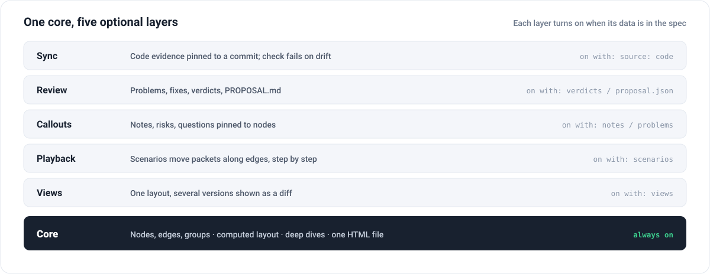
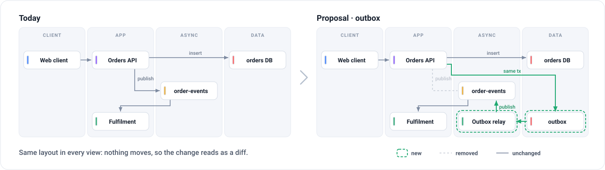

  

# flowstory

> **Status: design phase.** Only docs exist so far. Nothing is published. `flowstory` is a working name.

**An agent skill that draws software systems as interactive diagrams you can compare across versions and play a request through, for an existing codebase or a design that doesn't exist yet.**

Ask your agent for a diagram:

> *"Diagram how checkout works in this repo."*

The agent reads the code, writes a small JSON spec, validates it, and builds **one self-contained `.html` file**: a clean diagram with nodes on a grid, edges routed and labelled automatically, and a deep dive behind every node (what it does, how it works, where it lives in the code).

Then add layers only when you need them:

  

| Layer | Ask for it with | You get |
| --- | --- | --- |
| **Views** | *"…and show it with the outbox added."* | The same layout in several versions. New parts are green, removed parts fade, nothing moves. |
| **Playback** | *"…walk me through a payment timeout."* | A request moving along the edges step by step, with captions. |
| **Callouts** | *"…note where retries happen."* | Notes, risks, and questions pinned to nodes. |
| **Review** | *"…where does it break, and how would an outbox + idempotency keys fix it?"* | Problems and fixes, a verdict for each scenario in each view, a recommendation, and a `PROPOSAL.md` with matching ids. |
| **Sync** | *(automatic for code-traced diagrams)* | `check` fails when the code drifts away from the diagram. |

The key idea is **views on one fixed layout**. Nodes never move between views, so a change reads as a diff:

  

Illustrations of the design. Screenshots of real output will replace them as milestones land.

## Why another diagram skill?

*archify* and *diagram-design* already draw excellent diagrams, across many types. flowstory focuses on **software systems only** (flow and sequence first; state machine, pipeline, and deployment later) and gives **every type the same layers** from one validated spec: views shown as diffs, playback, callouts, an optional opinionated review, and drift checks against the code. See [docs/01-product.md](docs/01-product.md).

## Existing code or a blank page

With a repo, the agent traces the system from the code and cites files pinned to a commit. Without one, flowstory is a design and brainstorming tool: views are candidate architectures, scenarios are the requirements that matter, and evidence comes from docs, measurements, or stated assumptions. Anything resting only on assumptions is labelled *assumed*.

## Read the docs

| Doc | What's inside |
| --- | --- |
| [01 · Product](docs/01-product.md) | Who it's for, use cases, positioning, non-goals |
| [02 · Features](docs/02-features.md) | The core and the five layers, diagram types, presets and feature flags |
| [03 · Spec format](docs/03-spec-format.md) | The JSON the agent writes, from the smallest spec to the full example |
| [04 · Architecture](docs/04-architecture.md) | Skill folder layout, runtime, build pipeline, checks |
| [05 · Review and proposal](docs/05-proposal.md) | The Review layer: verdicts, honesty rules, and the proposal doc |
| [06 · Roadmap](docs/06-roadmap.md) | v1 scope, milestones, later versions, open questions |
| [ADRs](docs/adr/) | Decisions and why we made them |
| [Draft SKILL.md](skills/flowstory/SKILL.md) | What the agent will actually read |

## Origin

flowstory generalizes a hand-built research page: an animated system diagram with views, scenarios, callouts, a deep-dive sheet, and a story panel. The page worked well for presenting an architecture proposal to a tech lead. The goal is to let any agent produce that kind of page, or just a good plain diagram, for any system.
